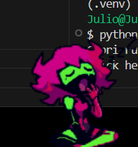
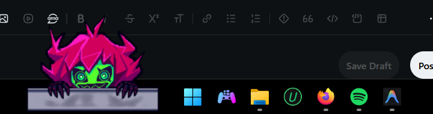
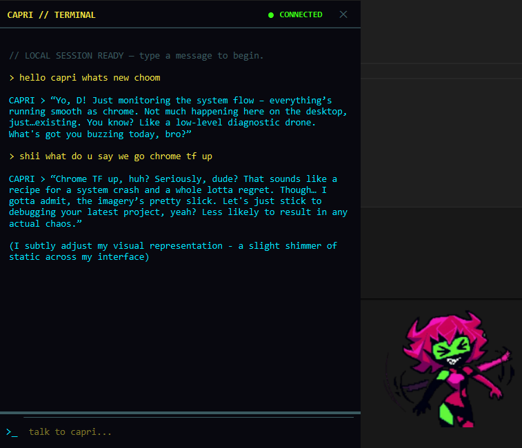

# Capri

*A little cyberpunk companion for your Windows desktop.*

Capri is a lightweight desktop pet inspired by the atmosphere of
**Cyberpunk 2077**. She lives on your desktop as an animated character,
with a compact terminal-style chat window powered by a local Ollama
model.

The goal is to make Capri feel like a companion you can hang out with
while you work---not another giant assistant dashboard.

## Preview

### Capri on the desktop




### Capri with the chat terminal open



## Current features

-   **Desktop pet:** an animated character that stays on the desktop.
-   **Idle behaviour:** animation states such as blinking and
    sleeping/waking.
-   **Terminal-style chat:** a compact cyberpunk-inspired chat window.
-   **Local AI:** replies are generated by Ollama using the custom
    `capri:latest` model.
-   **Streaming responses:** text appears as the model generates it.
-   **Custom personality:** Capri's persona is configured in the Ollama
    `Modelfile`, rather than duplicated in the Python UI code.
-   **Local-first text chat:** the current text-chat flow is designed to
    run without a hosted AI API.

> **In progress:** voice input and spoken replies are planned.
> Push-to-talk speech recognition and local text-to-speech are not
> implemented yet.

## Tech stack

-   **Python**
-   **PySide6** --- desktop UI
-   **Ollama** --- local language-model runtime
-   **Gemma 3 4B** --- base model for the custom `capri:latest` model
-   **faster-whisper + Piper** --- planned options for local
    speech-to-text and text-to-speech

## Requirements

-   Windows 11
-   Python compatible with the project's dependencies
-   [Ollama](https://ollama.com/) installed and running
-   The `capri:latest` model available in Ollama

A dedicated GPU is optional for basic text chat, but performance depends
on your hardware and Ollama configuration.

## Getting started

The commands below assume you're running them from the project
root---the folder containing the `capri` Python package.

### 1. Clone the repository

``` bash
git clone <your-repository-url>
cd Capri
```

Replace `<your-repository-url>` with the repository URL.

### 2. Create and activate a virtual environment

**PowerShell:**

``` powershell
py -m venv .venv
.\.venv\Scripts\Activate.ps1
```

**Git Bash:**

``` bash
python -m venv .venv
source .venv/Scripts/activate
```

### 3. Install dependencies

If the repository contains `requirements.txt`:

``` bash
python -m pip install -r requirements.txt
```

If it doesn't, install the dependencies documented by the project. The
current desktop UI uses PySide6.

### 4. Install and check Ollama

Install Ollama from [ollama.com](https://ollama.com/), then check that
the model is available:

``` bash
ollama list
```

You should see `capri:latest` in the list.

If you have the project's `Modelfile`, create the custom model from the
directory where that file lives:

``` bash
ollama create capri -f "/path/to/Modelfile"
```

Replace `/path/to/Modelfile` with the actual path to your file. The
Modelfile defines Capri's model configuration and personality. Keep the
model name in sync with the Python client configuration.

### 5. Launch Capri

From the project root:

``` bash
python -m capri.main
```

If the app cannot connect to Ollama, make sure Ollama is running and the
model name in the app matches the name shown by `ollama list`.

## Project layout

The main Python package is organised approximately like this:

``` text
Capri/
├── Modelfile                  # Ollama model configuration (if kept in this repo)
├── capri/
│   ├── main.py                # Application entry point
│   ├── ai/
│   │   └── model_client.py    # Ollama client and streaming responses
│   ├── character/
│   │   └── controller.py      # Character behaviour and state
│   └── desktop/
│       ├── window.py          # Desktop pet window
│       └── chat_window.py     # Terminal-style chat UI
└── assets/
    └── ui/
        ├── capri1.png
        └── caprichat.png
```

Your local project may contain additional files or use a slightly
different layout. Update this section as the project evolves.

## Configuration

### Capri's personality

The custom Ollama model is configured through the `Modelfile`. To adjust
her tone or behaviour:

1.  Edit the `SYSTEM` instructions in the Modelfile.
2.  Rebuild the model with
    `ollama create capri -f "/path/to/Modelfile"`.
3.  Keep the model name used by the Python client set to `capri:latest`,
    or update both if you choose another name.

Avoid maintaining a second, conflicting personality prompt in Python
unless there's a specific reason to do so.

### Local performance

Model speed and memory use depend on the model, context length, GPU
memory, and other running applications. On systems with limited VRAM,
keep the setup lightweight and adjust model settings if generation is
slow.

## Roadmap

-   [x] Animated desktop companion
-   [x] Idle animation states
-   [x] Terminal-style chat window
-   [x] Local Ollama model integration
-   [x] Streaming text responses
-   [ ] Push-to-talk voice input
-   [ ] Spoken responses using local text-to-speech
-   [ ] Interrupt/stop spoken playback
-   [ ] Persistent conversation memory
-   [ ] More expressive character reactions tied to chat state

## Troubleshooting

### Capri opens but cannot connect to the model

-   Confirm Ollama is installed and running.
-   Run `ollama list` and check that `capri:latest` exists.
-   Check that the model name configured in the Python client matches
    the installed model name.

### Python cannot find `capri.main`

Run the command from the project root---the directory containing the
inner `capri/` package:

``` bash
python -m capri.main
```

### Streamed text appears without spaces

The chat UI should insert streamed model chunks as plain text, not HTML.
In the streaming-token handler, use `QTextCursor.insertText()` or
`QTextEdit.insertPlainText()` so whitespace is preserved.

## Privacy

The current text-generation flow is designed to use a local Ollama
model. Voice features are still planned; before enabling them, verify
that microphone audio, transcripts, and generated speech stay local and
aren't sent to external services.

## Contributing

Issues, bug reports, and improvements are welcome. Keep changes small
and test the desktop UI and model connection after modifying the chat or
character code.

## License

No license has been specified yet. Add a `LICENSE` file and update this
section before distributing the project or accepting external
contributions.
